<div align="center">


# 研纪 · 中医诊疗全过程辅助学习工具

**一款离线优先、以中医经典与确定性业务规则为基础，结合 AI 理解和讲解能力的中医诊疗全过程辅助学习 App**

离线可用 · 数据全本地 · 无需注册 · 开箱即用


[](https://flutter.dev)
[](https://dart.dev)
[]()
[](docs/fork-license-boundary.md)
[](https://github.com/just2512/nihaixia-app/stargazers)

<br/>

**[📦 版本获取与本地安装](#-版本获取与本地安装)** · **[📖 快速上手](#-快速上手)** · **[🏗️ 技术架构](#️-技术架构)** · **[🗺️ Roadmap](#️-roadmap)** · **[🤝 贡献指南](#️-贡献指南)** · **[📄 开源许可](#-开源许可)**

</div>

---

## 📖 项目简介

> 「中医很简单，就是阴阳气血。你搞懂了，一通百通。」—— 倪海厦

**研纪** 是一款面向中医诊疗全过程学习的软件，帮助用户从四诊问诊、信息整理与补问，逐步理解辨病、辨证、病机、治法、方剂配伍、针灸取穴，以及经典依据和医案复盘。核心知识库支持离线检索。

- **六经规则问诊**：由 App 既有问诊流程和确定性规则引擎执行，展示实际规则结果及其可追溯的本地知识依据；
- **经典与知识检索**：经方、本草、穴位、针灸资料、医案和经典著作可在本地查阅、关联与复盘；
- **AI 辅助理解与讲解**：AI 协助理解自然语言、提示缺失信息、引导补问并解释已验证的业务结果；辨病辨证结论由 App 既有确定性业务代码产生，AI 不凭自身推断生成或覆盖结论；
- **传统文化工具**：黄帝内经、紫微、易经、四柱等模块按各自领域提供资料检索、计算与文化解释。

### 项目身份与上游关系

当前对外名称及包身份边界以[研纪品牌与应用身份规范](docs/brand-identity.md)为准。

研纪由 **just2512** 基于上游开源项目发展并持续独立维护。当前仓库拥有自己的产品定位、功能规划、代码改进、版本号、更新记录和发布渠道；对外产品名称与应用版本均以本仓库为准。

本仓库继续保留 GitHub Fork 关系及上游来源：感谢 [jangviktor-web/nihaixia-app](https://github.com/jangviktor-web/nihaixia-app) 原作者提供的开源基础。上游代码更新不会自动合入；需要引入时，按 [Fork 独立维护与上游同步策略](docs/fork-maintenance-policy.md) 逐项评估、人工审查和测试。保留上游关系不代表使用上游版本号、Release 或 APK。

### 核心价值主张

| 维度 | 说明 |
|:---|:---|
| 🔒 **离线优先** | 所有知识库打包进 App，无网络也能用，隐私数据不出本机 |
| 📚 **经典还原** | 严格遵循倪师"生附子、炮附子不可取代"等口径，附子按体系拆分，方剂组成零死链 |
| 🧠 **规则与 AI 协作** | App 确定性模块负责问诊、辨病辨证与计算；AI 负责理解、引导、解释和知识串讲，不覆盖业务结果 |
| 🆓 **完全免费** | Apache 2.0 开源协议，无广告、无内购、无追踪 |
| 🧪 **测试守护** | 关键辨证路径与筛选逻辑均有回归测试，修复即写测试，防止复发 |


### 本地 AI 与 OPPO Find N2 说明

- [Gemma 4 E4B 下载、SHA-256 校验、运行配置与实机验收](docs/local-ai-e4b.md)：模型文件约 3.66 GB，不打包进 APK；必须从文档中的固定版本链接单独下载并导入。
- [OPPO Find N2 本地实机验收交接单](docs/local-real-device-acceptance-handoff.md)：涵盖原签名无损覆盖升级、品牌与折叠屏、E4B GPU/CPU 多轮、TRACE、专业版 ai_access Native Gate 及证据回传。
- [Find N2 内外屏适配与品牌视觉方案](docs/find-n2-adaptive-layout.md)：包含外屏/内屏导航策略、图标资源与真机验收要求。
- [折痕/铰链布局与窗口指标采集](docs/find-n2-fold-aware-layout.md)：Debug APK 使用 `[WINDOW_METRICS]` 诊断；Windows PowerShell 可运行 `tool/capture_find_n2_metrics.ps1`，仅导出窗口指标，不清空设备 logcat 缓冲。

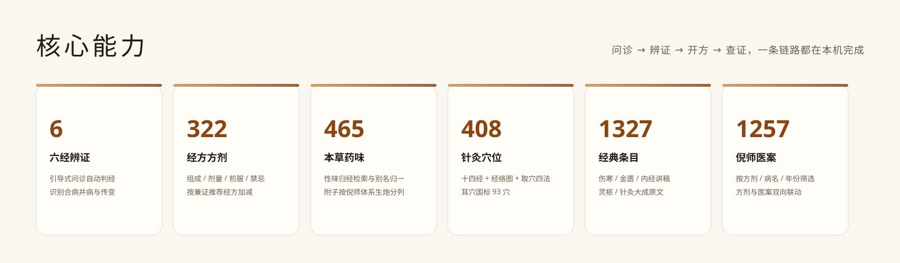

---

## 📷 截图

<div align="center">

**问诊引导 · 六经速查 · 方剂速查**

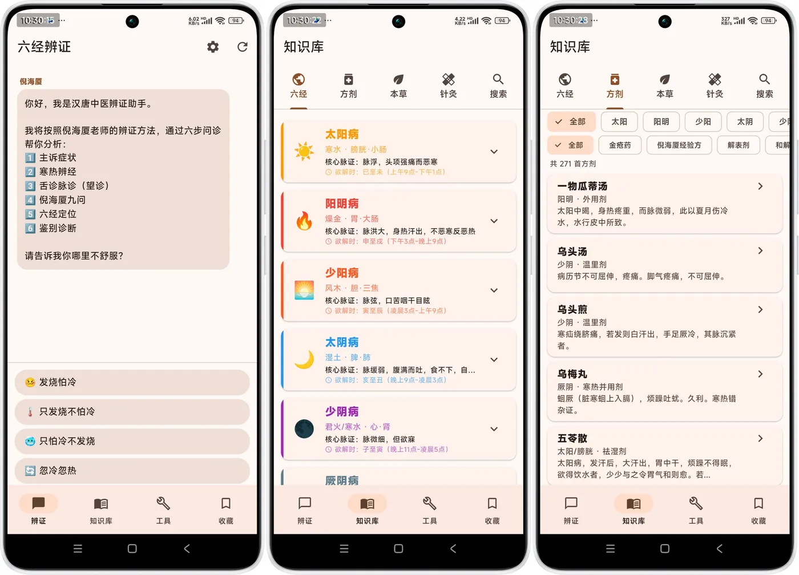

**本草速查 · 针灸穴位 · 实用工具**

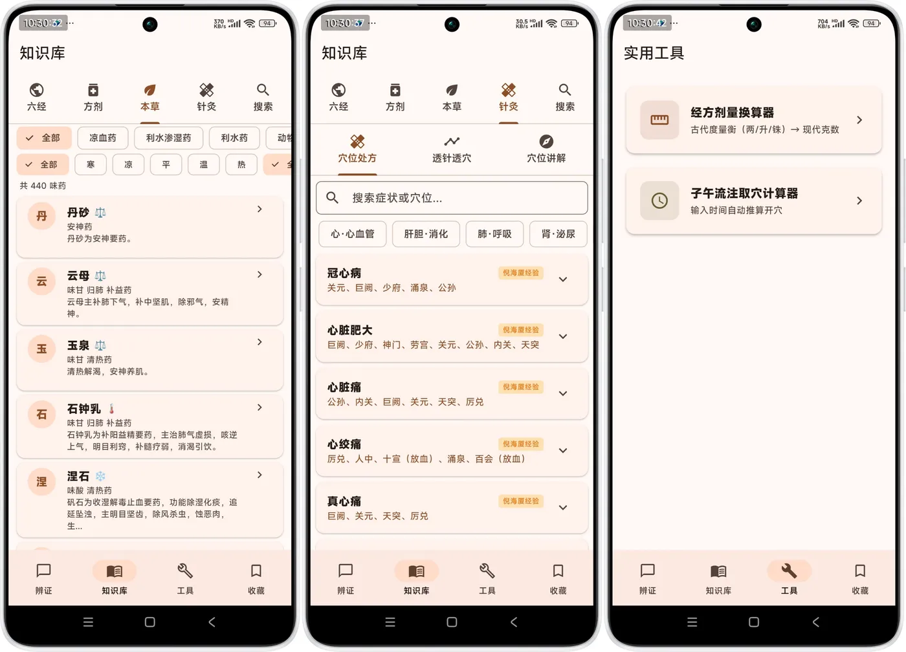

**四柱命卦 · 紫微斗数排盘 · 易经六十四卦**

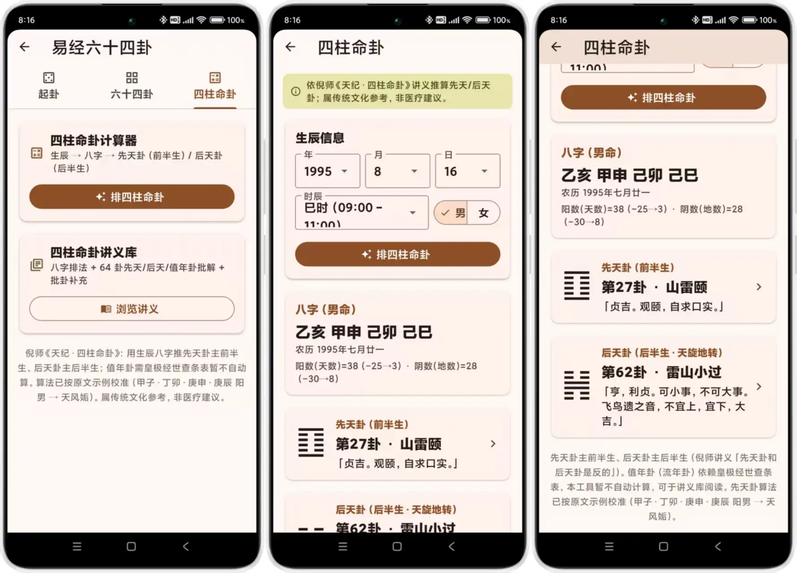
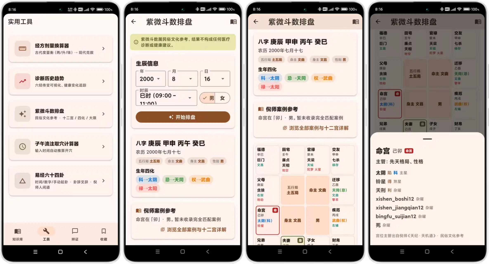
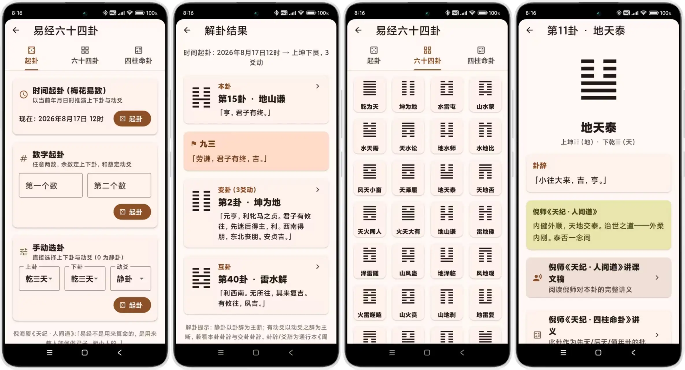

**倪师医案库 · 闭门课重症临床 · 六爻铜钱摇卦 · 实用工具**

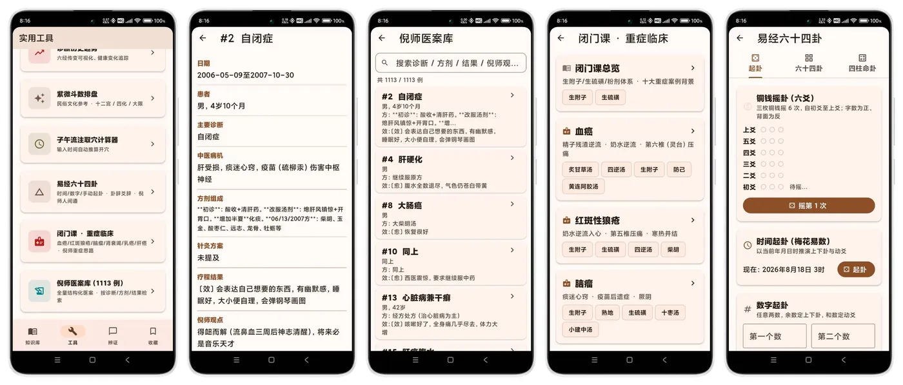

**黄帝内经：脏象 · 望诊 · 脉诊 · 73 篇阅读库**

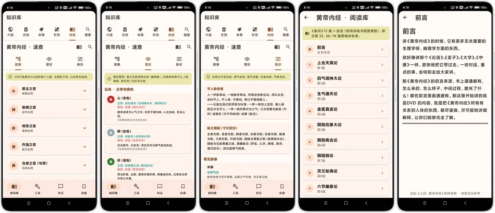

**倪师闭门课内容 · 倪师精选医案**


**添加每日黄历、节气养生模块 ·  优化紫微斗数星盘大运、流年月详解功能及“真太阳时”选择地名自动匹配功能**


**v1.11.13 每日黄历 · 生肖相冲 / 玉匣记神仙节日 + 潮汕节俗 / 玉匣灵兆模块**

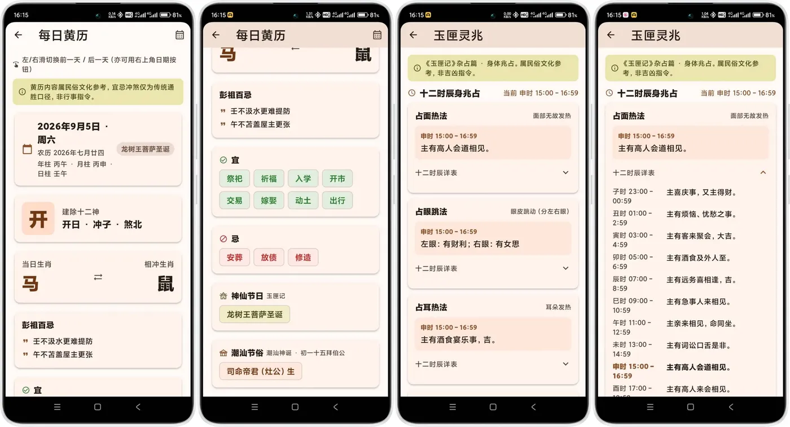

从左到右：① **每日黄历 · 生肖相冲** —— 依每日地支经六冲推算当日相冲生肖（如子日冲马），一眼看清。 ② **每日黄历 · 玉匣记神仙节日 + 潮汕节俗** —— 玉匣记收三元五腊圣诞（114 条）、十殿阎君（10 条）与斋期，共 125 个农历日；潮汕地方条目单列（如「司命帝君」「灶公生」），与既有传统节日运行时去重互不覆盖。 ③ **玉匣灵兆 · 占面热法** 与 ④ **玉匣灵兆 · 占眼皮法** —— 玉匣记身体兆占，十二时辰各占断，当前时辰自动高亮，可展开十二时辰详表（左眼跳财、右眼有女思等）；工具页新增入口，附民俗参考免责声明。

**v1.11.17 周公解梦 · 小儿关煞 · 紫微早晚子时校正**

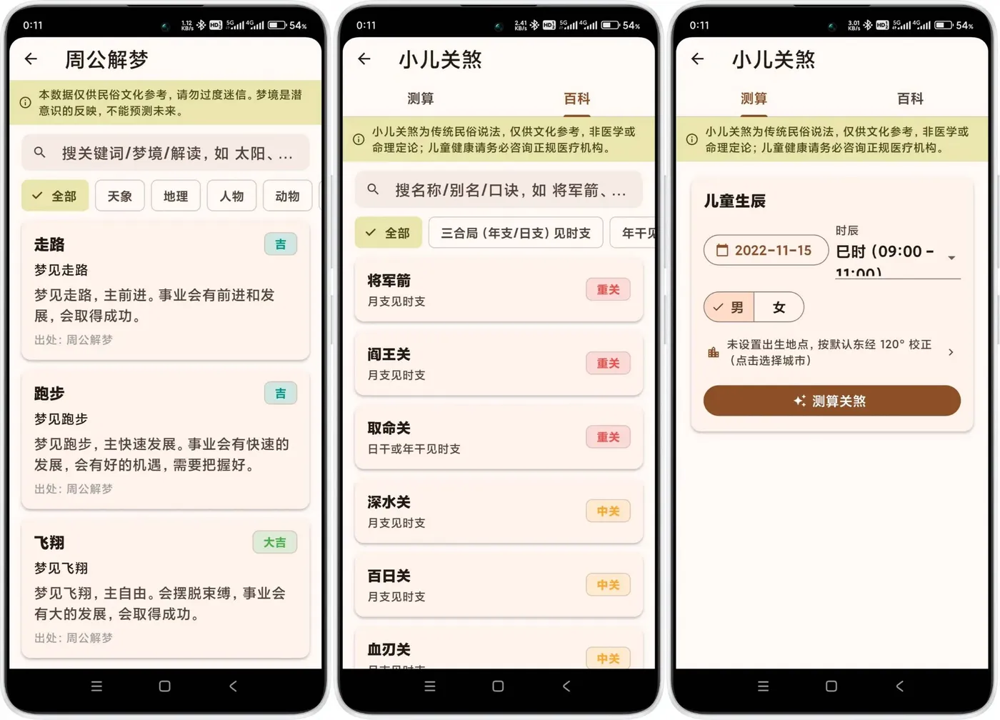

新增「周公解梦」模块（412 条梦境民俗解读，关键词/分类检索，吉凶标注）；新增「小儿关煞」模块（36 关 + 18 扩展煞，支持测算与百科检索，附民俗文化参考免责声明）；紫微排盘早晚子时校正重构，原始出生时间只读、农历显示跟随校正后的干支。

**v1.11.19 内经结构化条目检索 · 节气养生**

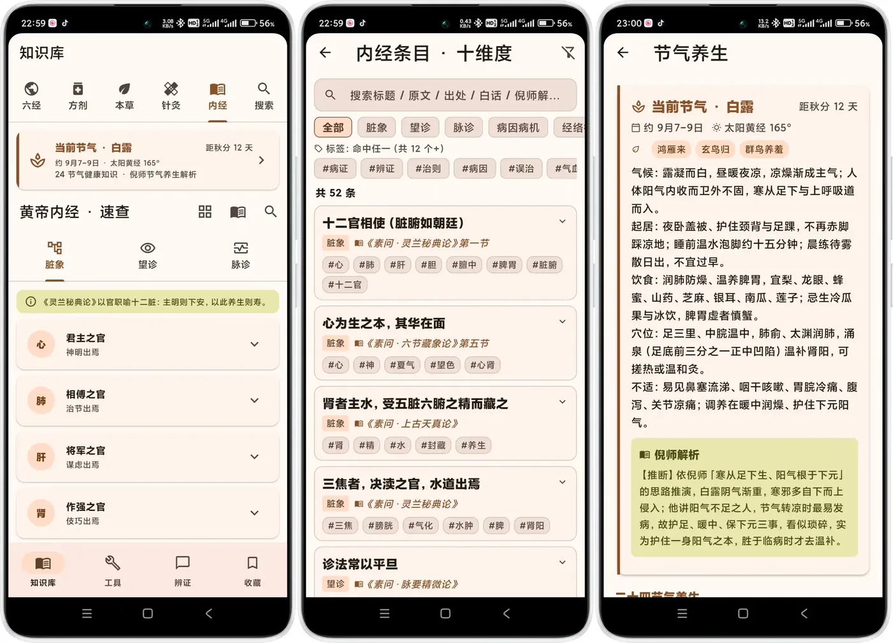

从左到右：① **知识库首页** —— 顶部「六经 / 方剂 / 本草 / 针灸 / 内经 / 搜索」六大入口，「当前节气」卡直显节气名、距下一节气天数、太阳黄经与三候，下方「黄帝内经·速查」脏象 / 望诊 / 脉诊三入口一览。 ② **内经条目 · 十维度** —— 52 条结构化条目按 10 个维度（脏象 / 望诊 / 脉诊 / 病因病机 / 经络循行 / 气血津液 / 辨证体系 / 治则方药 / 病证举例 / 误治宜忌）检索，支持六字段搜索（标题 / 原文 / 出处 / 白话 / 倪师解）、按篇名检索与标签交叉筛选；每条卡片显式标注篇名出处（如《素问·灵兰秘典论》第一节）。 ③ **节气养生详情** —— 24 节气逐条给出气候 / 起居 / 饮食 / 穴位 / 不适五类养生要点，并附「倪师解析」卡片，非原文直引处统一标注【推断】，一眼可分「经典原文 vs 解读」。

**v1.11.24 穴位筛选新增六奇经分组 · 国标穴序**


穴位讲解的经络筛选从 15 组扩到 **21 组**：十二正经 + 督任之外，新增**冲脉 / 带脉 / 阴维脉 / 阳维脉 / 阴跷脉 / 阳跷脉**六个奇经分组；57 条交会穴补齐所属经脉标注，多脉穴忠实出现在所有所属脉分组（如公孙同时在「脾经」与「冲脉」），搜「冲脉」等可直接命中其交会穴。随版带出：十二正经 / 督任组内按国标穴序排列、同名并列穴位次键修复、「子宫」解剖语境禁链。

**v1.11.23 伤寒论 / 金匮要略 条文级阅读库 · 方剂⇄条文双向联动**

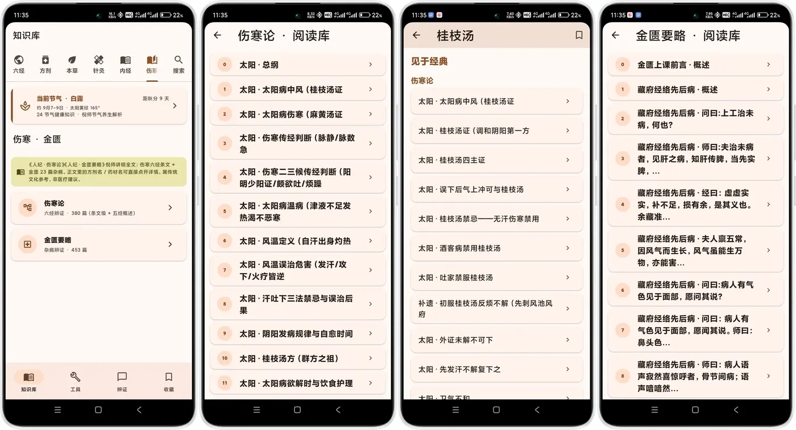

从左到右：① **知识库新增「伤寒金匮」Tab** —— 伤寒论 380 篇（条文级 + 五经概述）与金匮要略 453 篇两个入口。 ② **伤寒论 · 阅读库** —— 23 大模块拆到条文级逐条排列（太阳·总纲 / 太阳病中风(桂枝汤证) / 太阳病伤寒(麻黄汤证) / 太阳病传经判断 ……）。 ③ **方剂「见于经典」** —— 以桂枝汤为例，分「伤寒论 / 金匮要略」两组列出**专门介绍该方**的条文，点按直达原文。 ④ **金匮要略 · 阅读库** —— 25 篇杂病按条文排列（藏府经络先后病、痉湿暍病、疟病 ……）。正文里的方剂名 / 药材名一点即跳对应详情，经方正文与方剂·药物首次**双向联动**。

**v1.11.25 易经 64 卦卦象插画 · 中医时辰开穴四法 · 五运六气三图**

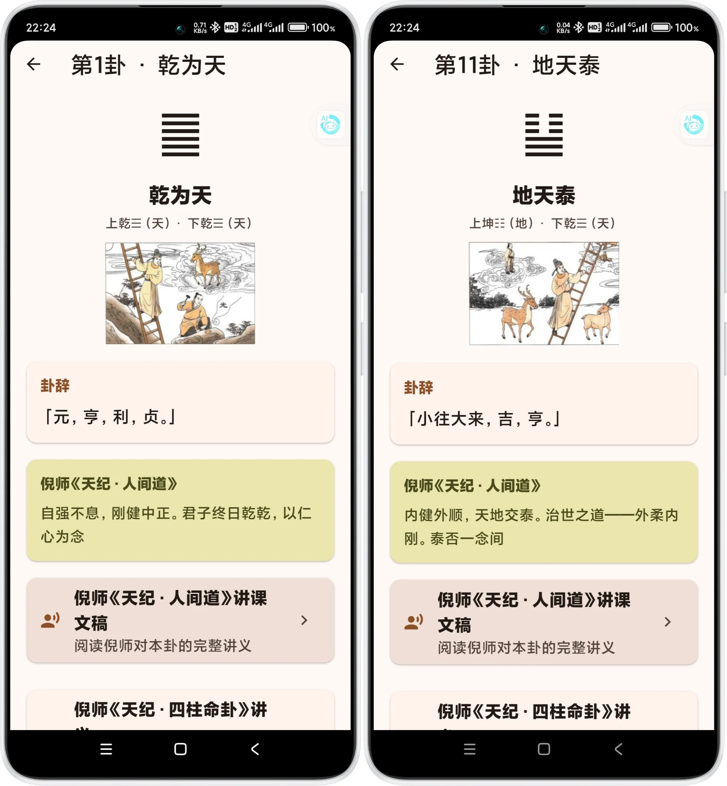

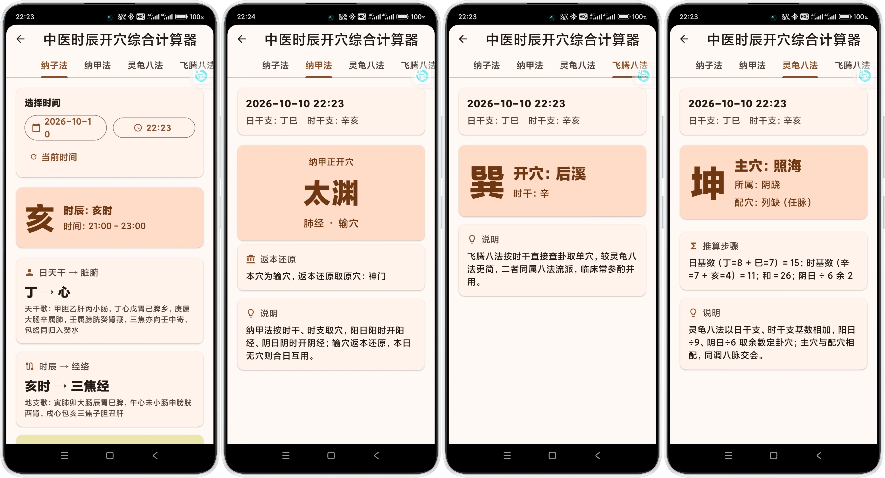

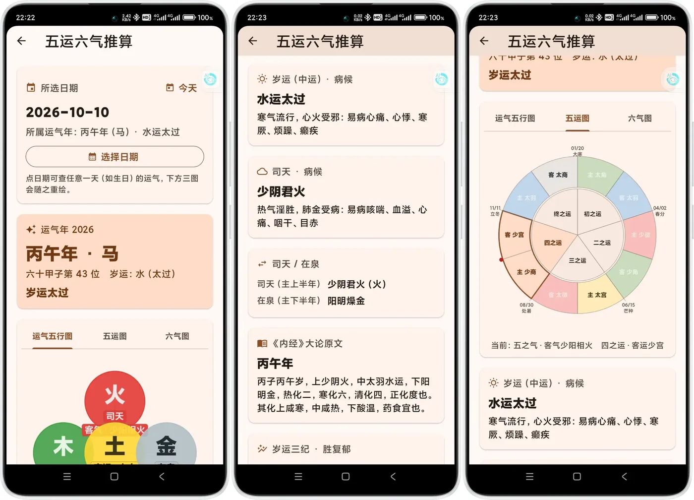

从左到右：① **易经 64 卦卦象插画** —— 每卦详情页卦名下方显示该卦的传统典故版画（乾为天 = 云中取鹿、地天泰 = 梯上取鹿），64 卦全覆盖，与卦名数据一一对应，缺图静默收起不影响页面。 ② **中医时辰开穴综合计算器 · 四法并排** —— 纳子法 / 纳甲法 / 灵龟八法 / 飞腾八法四个 Tab，点选或按「当前时间」即时给出日干支与时干支，并显示开穴（纳甲正开 · 太渊「肺经·输穴」、飞腾八法 · 后溪、灵龟八法 · 照海配列缺），附「返本还原」还原取原穴、干支→脏腑/经络对应歌诀、推算步骤与说明。 ③ **五运六气三图** —— **运气五行图**（十字五宫夹中央，司天/在泉与五行圆形联动）、**五运图**（单环十扇区，主运/客运分色并标出步界日期）、**六气图**（双环）；任选一天（如生日）三图随之重绘，当前步高亮，下方给出岁运（中运）病候、司天/在泉、客气加临与《内经》大论原文。

**v1.11.26 耳穴国标定位图 · 十四经循行穴位图 · 五运六气三图排版修复**

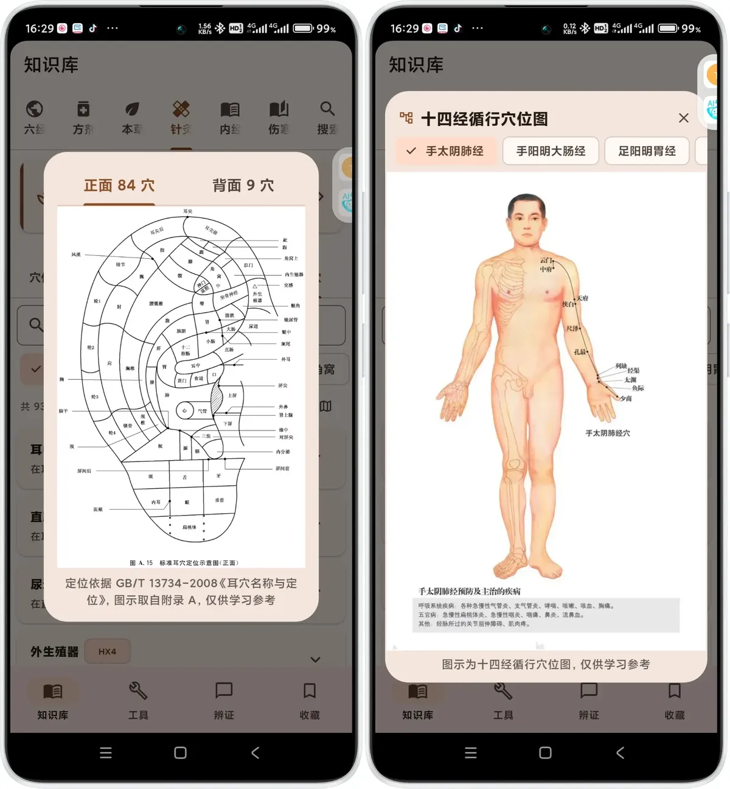

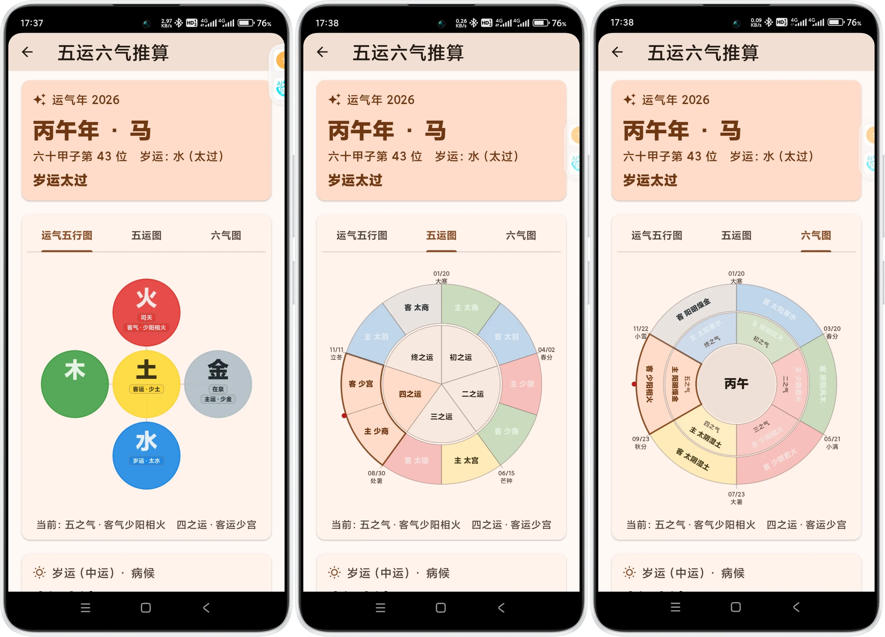

从左到右：① **耳穴国标定位图** —— 耳穴地图内嵌 GB/T 13734-2008《耳穴名称与定位》附录 A 标准图，「正面 84 穴 / 背面 9 穴」两页签，双指放大细看穴名，页内标注「仅供学习参考」；配套「耳穴」库 93 穴按国标分区（HX/SF/AH/CO……）筛选，穴名 / 拼音 / 代码均可检索。 ② **十四经循行穴位图** —— 穴位讲解新增「经络图」入口，十二正经 + 任督二脉共 14 张循行图，经络走行、所属穴位与该经「预防及主治的疾病」一图看全，双指放大 6 倍看清穴名。 ③–⑤ **五运六气三图排版修复** —— **运气五行图**五宫半径与间距重新配比，徽章不再横跨压字；**五运图**主客运分色、步界日期清晰；**六气图**「外环客气 / 内环主气 / 步名」三层文字改沿扇区切线排布，3 点与 9 点方向不再叠压；任选日期三图即时重绘、当前步自动高亮（图为 2026 丙午年）。

**v1.11.27 三山国王灵签 · 小六壬 · 梅花易数 · 排盘存图分享长图 · 摇一摇起卦**

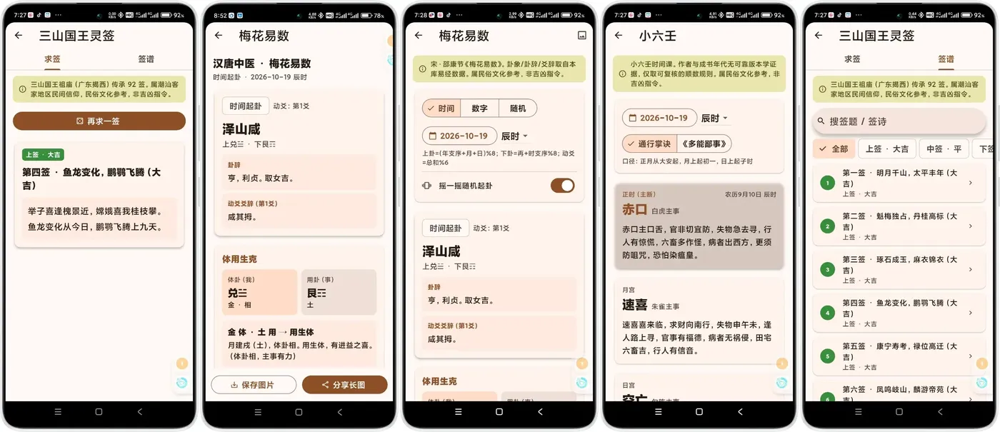

从左到右：① **三山国王灵签 · 求签** —— 收录广东揭西三山国王祖庙传承 92 签，每签含签号 / 签题 / 签诗原文 / 吉凶等级；默念所问之事后摇取签文，可反复再求。② **梅花易数 · 排盘结果** —— 随机起卦得「泽山咸」，动爻、卦辞、动爻爻辞与体用生克推演一屏看全；AppBar 图片入口进入长图预览页，「保存图片」（存本机、**无需存储权限**）与「分享长图」（调起系统面板，可转存相册 / 文件 / 微信）两个出口。③ **梅花易数 · 摇一摇起卦** —— 输入区「摇一摇随机起卦」开关默认开启，摇动手机即自动切随机起卦并重摇一卦（不动已输入的时间 / 数字），触觉反馈确认；一次摇动只出一卦，缓慢倾斜不误判。④ **小六壬** —— 时间起课，月 / 日 / 时三宫顺数定大安 / 留连 / 速喜 / 赤口 / 小吉 / 空亡，配主事六神与歌诀；术内对「月初一落宫」本有分歧，**「通行掌诀」与《多能鄙事》双口径并列**由使用者自选，推算过程完整展示。⑤ **三山国王灵签 · 签谱** —— 92 签全量列表，按吉凶（上 42 / 中 31 / 下 17 / 无事 2）筛选 + 签题与签诗全文检索，点按弹出完整签文。三个模块均标注民俗文化参考免责声明，与经方医疗模块清晰分隔；存图长图同适用于八字排盘 / 紫微斗数 / 五运六气结果页。


</div>

---

## ✨ 核心功能与特性亮点

| 功能 | 说明 | 数据规模 |
|:---|:---|:---:|
| 🩺 **六经辨证诊断** | 智能问诊引导，自动判断太阳/阳明/少阳/太阴/少阴/厥阴，并支持合病并病 | 6 经 |
| 💬 **患者口语画像** | 辨证结果页展示「患者会怎么说」——大白话主诉 + 辨证指针 + 治法 + 原文条文，可逐句自核；并让"怕冷/怕风"等现代症状词召回古文方剂（增强分上限 < 1，保证不打乱原有正确排序） | 170 首 |
| 📋 **完整处方生成** | 自动显示组成、剂量、煎服法、禁忌，推荐经方加减 | 23 条规则 |
| 🔍 **鉴别诊断** | 自动对比相似证型的关键区别，辅助精准辨证 | 26 对 |
| 📚 **方剂速查** | 搜索 + 六经筛选 + 分类筛选，离线查阅 | 322 首 |
| 🌿 **药物速查** | 搜索 + 分类/性味/归经三筛选，覆盖《神农本草经》全量，附子按倪师体系拆分生/炮两条 | 465 味 |
| 📍 **针灸穴位速查** | 十四经脉 + 经外奇穴，含定位/针刺/灸法/禁忌/临床心悟，穴位↔处方双向关联 | 408 穴 |
| 💉 **穴位处方·透针** | 14 类针灸处方（257 条）+ 31 条透针透穴，组成穴可点按跳转 | 14 类 |
| ⏰ **子午流注取穴** | 输入时间自动推算开穴 | 361 穴 |
| 🔧 **经方剂量换算** | 古代度量衡（两/升/铢）→ 现代克数 | — |
| 📖 **黄帝内经** | 脏象 12 卡 + 望诊（五色/眼诊）+ 脉诊（平人/死脉）+ 73 篇阅读库 + 全文搜索；新增「结构化条目检索」52 条 / 10 维度，原文·出处·白话·倪师解读四字段分离，支持六字段搜索 + 维度 + 标签交叉检索 | 73 篇 + 52 条 |
| 📜 **伤寒论 · 金匮要略 条文库** | 伤寒论 380 篇 + 金匮要略 453 篇拆到条文级逐条阅读；正文方剂/药材名一点即跳详情，方剂详情「见于经典」反向标注出处条文 | 833 条 |
| 📜 **古籍原文** | 《灵枢》82 章 + 明代《针灸大成》339 章原文，章节目录可搜正文，方剂/药名可点跳；全局搜索「经典」分组贯通讲稿与原文 | 421 章 |
| 📚 **倪师医案库** | 1257 例检索 + 闭门课重症临床模块，医案 ↔ 方剂双向联动 | 1257 例 |
| 🎲 **六爻铜钱摇卦** | 三枚铜钱逐爻摇卦，多动爻自动变卦 | 民俗参考 |
| 📜 **易经六十四卦** | 时间/数字/手选起卦，解本卦·动爻·变卦·互卦，集成人间道 64 卦讲课文稿 | 64 卦 |
| ☯️ **四柱命卦** | 先天/后天卦推算（天地数法），附倪师四柱命卦讲义库 | 64 卦 |
| 🔮 **紫微斗数排盘** | 十二宫/主星/四化/大限/流年盘可视化，杂星全中文，支持真太阳时+经度；排盘后自动生成整体运势/十年大运/流年总结，并给流年疾厄宫健康提醒（民俗文化参考） | 115 星 |
| 📊 **八字详批** | 神煞/格局/日主强弱/五行分布/用神忌神，一键详批 | 民俗参考 |
| 💾 **我的命盘库** | 紫微排盘结果可命名收藏，列表管理、左滑删除、点击回看（回填生辰与城市重排），省去反复输入 | — |
| 🍂 **节气养生板块** | 独立 24 节气板块，每条附健康养生要点 + 倪师节气解析（非原文标注【推断】），与本草库解耦 | 24 节气 |
| 👆 **每日黄历手势** | 黄历支持上/下滑切日、左/右滑切月，单手翻看更顺手，保留日期选择器兜底 | — |
| 🔁 **大运对宫解析** | 大限空宫时自动附对宫主星/煞星提示，紫微「借星安宫」惯例可视化 | — |
| ⚙️ **诊断设置** | 默认性别/诊断详细度/自动复制处方，个性化问诊体验 | 3 项 |
| 💾 **数据管理** | 清除历史/导出收藏/清理缓存，本地数据完全掌控 | — |

> **特别说明**：紫微斗数、易经、四柱、六爻等模块为**中国传统民俗文化参考**，非医疗诊断用途，与经方医疗模块在界面与文案上清晰分隔。

---

## 📦 版本获取与本地安装

> 当前源码版本：`2.0.0+8048`（`versionName=2.0.0`，`versionCode=8048`）。
> 本版本处于 `PREPARATION / NOT RELEASED`，不代表正式 APK 已构建、签名或完成真机验收。
>
> **分发方式：本地构建、原签名、本地交付。** 本仓库不创建发行 Tag、不发布 GitHub Release、不上传正式 APK。不要从上游仓库下载 APK，也不要把本仓库 Releases 页面当作下载渠道。
>
> 核心知识库可离线；本地 AI 模型需单独下载；无需注册；Android 7.0+。

### V1.11.30 发布准备内容

> **Find N2 折叠屏适配 · 本草讲稿与经典资料扩展 · 助手对话内工具执行 · 编辑型阅读界面**：补齐 335 篇本草讲稿及药材详情回链，保留伤寒上游板书为独立资料项；助手可在同一对话中查询本机时辰资料；修复 Find N2 展开/半折叠工具布局、紫微命盘整屏查看和易经/剂量换算窄屏溢出；统一知识浏览、经典阅读与核心详情页排版。真机验收仍待本地完成。

### 本地构建与覆盖升级

正式 Release 构建必须配置 `android/key.properties`，并使用**与设备现有安装包相同的原始签名证书**。Gradle 的 Release 签名门禁为 fail-closed：缺少签名配置、必填字段或 keystore 文件时应直接失败，不得回退到 Debug 签名。

本地构建、证书比对、`adb install -r` 覆盖升级和 OPPO Find N2 实机验收步骤见 [本地 Android 构建与升级检查清单](docs/local-android-release-checklist.md)。签名不一致、包名不一致或新版 versionCode 不高于旧版时必须停止，**不得卸载旧版或清除应用数据**。

### 历史更新日志

<details>
<summary><b>历史更新日志</b></summary>

> **V1.11.24 穴位筛选新增六奇经分组 · 国标穴序**：经络筛选从 15 组扩到 21 组，新增冲脉 / 带脉 / 阴维脉 / 阳维脉 / 阴跷脉 / 阳跷脉；57 条交会穴补齐次键标注，多脉穴忠实出现在所有所属脉分组（公孙同时在「脾经」与「冲脉」），搜「冲脉」可直接命中其交会穴；随版带出十二正经 / 督任组内国标穴序、同名并列次键修复与「子宫」禁链。详见 [Release Notes](release_notes/v1.11.24.md)。
> 
> **V1.11.23 伤寒论 / 金匮要略 条文级阅读库 · 方剂⇄条文双向联动**：知识库新增「伤寒金匮」Tab，伤寒论 380 篇、金匮要略 453 篇由「一章一个大文件」拆到**条文级**逐条阅读；正文里的方剂名/药材名一点即跳详情，方剂详情「见于经典」反向列出**专门介绍该方**的伤寒论/金匮条文；同时修复 Markdown 阅读页正文链接点击无反应。详见 [Release Notes](release_notes/v1.11.23.md)。
> 
> **V1.11.22 黄历神诞检索 · 记梦/身兆记录 + 民俗命理工具集**：自 v1.11.19 起三重增强——工具箱入驻「袁天罡称骨 / 受生债查询 / 轩辕黄帝四季歌」三大民俗参考，并按中医/玄学区划清晰分区（修复日期选择器英文回退）；黄历与周公解梦/玉匣灵兆新增「神诞检索 / 记梦 / 身兆记录」随身入口，全部复用 Bookmark 体系、零新表零迁移。详见 [Release Notes](release_notes/v1.11.22.md)。
> 
> **V1.11.19 内经结构化条目检索 · 深色模式正文修复 · 早晚子时农历校正**：新增「《黄帝内经》结构化条目检索」页（52 条 / 10 维度，原文·出处·白话·倪师解读四字段分离，六字段搜索 + 维度 + 标签交叉检索）；修复 Markdown 阅读页深色模式白字压浅蓝底不可读（对比度 1.09→9.50）；修复早晚子时 × 真太阳时下农历落后一天、时柱落亥时。详见 [Release Notes](release_notes/v1.11.19.md)。
> 
> **V1.11.17 周公解梦 · 小儿关煞 · 早晚子时校正约束落地**：新增「周公解梦」模块（412 条梦境民俗解读，关键词/分类检索，吉凶标注）；新增「小儿关煞」模块（36 关 + 18 扩展煞，支持测算与百科检索，附民俗文化参考免责声明）；紫微排盘早晚子时校正重构，原始出生时间只读、农历显示跟随校正后的干支。详见 [Release Notes](release_notes/v1.11.17.md)。
> **V1.11.15 命盘库双排盘入口 · 黄历通胜要览 · 本命相冲预警**：命盘库点击已存命盘可选「紫微 / 八字」排盘，生辰自动带入立即排盘；八字排盘页补上「添加到命盘库」入口（与紫微共用命盘库）；每日黄历新增「通胜要览」卡（黄道吉时 + 财神/喜神/福神方位）与本命相冲预警；切日手势改横向拖拽防误触；宜忌双栏合并。详见 [Release Notes](release_notes/v1.11.15.md)。
> **V1.11.13 八字神煞扩展 · 黄历神仙节日/生肖相冲/潮汕节俗 · 玉匣灵兆**：八字排盘新增 11 种神煞（太极贵人/国印/金舆/福星贵人/德秀/红鸾/天喜/孤辰/寡宿/劫煞/亡神）；每日黄历新增三张卡片——玉匣记神仙节日（125 个农历日）、生肖相冲（当日地支→相冲生肖）、潮汕节俗（94 个农历日），三源运行时去重互不覆盖；新增民俗模块「玉匣灵兆」（玉匣记身体兆占：十二时辰兆占 + 鸦鸣鹊噪 + 占灯花）。详见 [Release Notes](release_notes/v1.11.13.md)。
> **V1.11.12 本草一键通 · 详情页三级结构**：药库列表/搜索每行可点进详情；医案与闭门课正文药材名（含异名）可点直达药物页；药物详情页相关内容改为「关联医案/关联闭门课/含此药方剂」三个入口 → 简洁列表 → 详情，页面更清爽。详见 [Release Notes](release_notes/v1.11.12.md)。
> 
> **V1.11.11 同药异名合并 · 异名检索修复**：18 组异名同种条目归一（479→461），检索收敛到唯一入口 matchesQuery，按旧名（如「茈胡」）也能命中「柴胡」；三盘合参与八字补全（十神/旬空/刑冲合害/长生十二神）落地。详见 [Release Notes](release_notes/v1.11.11.md)。
> 
> **V1.11.10 命盘随身 · 节气养生**：新增「我的命盘库」（生辰存一次、随时回看）、独立「节气养生」板块（24 节气健康要点 + 倪师节气解析）、每日黄历滑动手势（上/下滑切日、左/右滑切月），以及大运空宫自动附对宫星情解析。四项民俗文化参考增强，全部离线、可测、不引入医疗诊断断言。详见 [Release Notes](release_notes/v1.11.10.md)。
> 
> **V1.11.9 让条文说人话**：为 170 首经方补齐「患者会怎么说」口语画像（大白话 + 辨证指针 + 治法 + 原文条文），辨证结果页新增口语卡片可逐句自核；同时让引擎听懂"怕冷""怕风"等现代症状词——原先这些词字面打不中古文条文、关联不到方剂的老毛病，已由口语语料兜底召回，并以「增强分上限 < 1」的非劣化不变式确保原有正确排序不被打乱。
> 
> **含 V1.11.8 健康人基线判定**、寒热真假八维法、六经公式分型速查等全部历史修复。
> 历史版本：V1.11.8 属于上游项目的历史发行版，不属于研纪在本仓库维护的独立发行记录。
</details>
   
### 本地从源码构建

需预先配置好 Flutter / Android 开发环境（见[快速上手](#-快速上手)），并先阅读[本地 Android 构建与升级检查清单](docs/local-android-release-checklist.md)。

```bash
git clone https://github.com/just2512/nihaixia-app.git
cd nihaixia-app
flutter pub get --enforce-lockfile
flutter analyze --no-pub --no-fatal-infos
flutter test --no-pub
# Release 必须配置原签名材料；缺少时按设计失败
flutter build apk --release
```

构建产物位于 `build/app/outputs/flutter-apk/`。如需分架构构建：

```bash
flutter build apk --release --target-platform android-arm64      # arm64-v8a
flutter build apk --release --target-platform android-arm        # armeabi-v7a
flutter build apk --release --target-platform android-x64        # x86_64
```

---

## 🚀 快速上手

### 环境要求

| 依赖 | 版本要求 | 说明 |
|:---|:---|:---|
| Flutter SDK | ≥ 3.47.0 | 与当前 `pubspec.yaml` 约束一致 |
| Dart SDK | ≥ 3.13.0 | 与当前 `pubspec.yaml` 约束一致，随 Flutter 一同安装 |
| Android 最低版本 | API 24（Android 7.0） | `minSdk = maxOf(flutter.minSdkVersion, 24)` |
| 操作系统 | Windows / macOS / Linux | 用于开发构建 |
| 设备/模拟器 | Android 7.0+ | 真机或模拟器运行 |

### 安装步骤

1. **安装 Flutter**：参考 [Flutter 官方安装指南](https://docs.flutter.dev/get-started/install)，并运行 `flutter doctor` 确认环境就绪。
2. **克隆仓库**：
   ```bash
   git clone https://github.com/just2512/nihaixia-app.git
   cd nihaixia-app
   ```
3. **安装依赖**：
   ```bash
   flutter pub get
   ```
4. **配置 Release 签名（仅正式包）**：将既有签名密钥信息填入 `android/key.properties`（参考 template）。不要生成新密钥替代已安装 App 的原签名证书；Debug 构建无需此步。

### 运行方法

```bash
# 连接设备或启动模拟器后，以调试模式运行
flutter run

# 运行测试套件
flutter test

# 静态分析
flutter analyze
```

---

## ⚙️ 详细配置选项说明

### 1. 应用内诊断设置（用户侧）

在 App「设置」中可调整：

| 选项 | 说明 |
|:---|:---|
| 默认性别 | 预设男/女/不设置，问诊时自动跳过性别选择 |
| 诊断详细度 | 简单模式（六经/证型/方剂/组成）或详细模式（完整处方、鉴别诊断、脉舌矛盾、用药铁律、汗法禁忌、传经预警、调护建议） |
| 自动复制处方 | 诊断完成时自动复制处方到剪贴板，便于抓药 |
| 暗黑模式 | 跟随系统或手动切换，六经六色与状态色自动适配亮/暗档 |
| 字体大小 | 调整阅读字号 |

### 2. 工程配置（开发者侧）

| 文件 | 作用 |
|:---|:---|
| `pubspec.yaml` | 依赖与资源清单，版本号 `X.Y.Z+N` 的单一来源（`+N` 即 Android `versionCode`） |
| `android/gradle.properties` | Gradle 堆内存等构建参数（Windows 上已设为 `-Xmx1024M` + `org.gradle.daemon=false` 以规避本机 OOM；CI 内由 workflow 临时覆盖为 `-Xmx4g` + G1GC，不影响本地） |
| `android/settings.gradle.kts` | 仓库源配置，已做 CI 感知：CI 直连 `google()`/`mavenCentral()`，本地保持阿里云镜像优先 |
| `android/app/build.gradle.kts` | Android 包标识、版本号与 Release 原签名门禁；缺少签名材料时阻止 Release 构建 |
| `android/key.properties` | 本地 Release 签名配置（不入库；必须使用既有签名密钥，参考 template） |
| `docs/local-android-release-checklist.md` | 本地构建、签名证书比对、覆盖升级和 Find N2 真机验收流程 |
| `assets/data/changelog.json` | 结构化更新日志，驱动「关于」页与更新弹窗 |
| `assets/data/formula_oral_hints.json` | 患者口语语料库（170 首方：口语 / 辨证指针 / 治法 / 原文条文） |
| `lib/theme/app_colors.dart` | 39 个语义色 Token（品牌棕/暖调中性/状态色/六经六色），全站硬编码颜色清零 |

**版本管理规范**：[研纪独立版本管理规范](docs/versioning-policy.md) 是产品版本治理的权威文件；`pubspec.yaml` 的 `version: X.Y.Z+N` 是唯一可编辑来源，`+N` 对应 Android `versionCode`。当前仓库版本为 `2.0.0+8048`，由 `tool/check_version_source.sh` 校验 README / pubspec / 规范一致性及共享 applicationId 版本码上限。

**发版方式**：维护者在本地使用原签名密钥构建正式 APK，并在完成证书、版本、覆盖安装与真机验收后线下或私下交付。本仓库不创建发行 Tag、不使用 GitHub Release 分发正式 APK。

---

## 🗂️ 项目目录结构

```
lib/
├── engine/                          # 引擎层（辨证/命理核心逻辑）
│   ├── diagnostic_engine.dart       #   六经辨证状态机
│   ├── diagnostic_rules.dart        #   诊断规则（合病·鉴别·加减）
│   ├── rule_engine.dart             #   规则引擎（双轨鉴别树）
│   ├── formula_rules.dart           #   方剂规则（113 方鉴别）
│   ├── formula_matcher.dart         #   方剂匹配器（基线 + 口语/指针加权，增强分上限 0.9 非劣化）
│   ├── meridian_formula_types.dart  #   六经公式分型（6 经 × 分型）
│   ├── yijing_engine.dart           #   易经六十四卦起卦引擎
│   ├── minggua_engine.dart          #   四柱命卦（先天/后天卦）引擎
│   └── bazi_analysis.dart           #   八字详批（神煞/格局/强弱/用神忌神）
├── models/                          # 数据模型
│   ├── diagnosis.dart               #   诊断结果 + 处方 + 加减
│   ├── formula.dart                 #   方剂模型
│   ├── formula_oral_hint.dart       #   患者口语语料模型（oral / indicators / treatment / sourceText）
│   └── herb.dart                    #   药物模型
├── data/                            # 数据层（仓库 + 离线数据源）
│   ├── formula_repository.dart      #   方剂仓库（4 级匹配策略，幂等加载）
│   ├── formula_oral_hint_repository.dart # 口语语料仓库（幂等加载，按方剂 id 索引）
│   ├── herb_repository.dart         #   药物仓库（别名归一）
│   ├── acupoint_repository.dart     #   穴位仓库
│   ├── acupuncture_repository.dart  #   针灸处方仓库
│   ├── disease_repository.dart      #   西医病名词典（约 150 正名 + 简繁别名）
│   ├── medical_case_data.dart       #   倪师医案库（1257 例）
│   ├── neijing_data.dart            #   黄帝内经知识卡
│   ├── yijing_data.dart             #   易经六十四卦数据
│   ├── minggua_data.dart            #   四柱命卦讲义数据
│   ├── changelog_repository.dart    #   更新日志仓库
│   ├── settings_repository.dart     #   设置仓库
│   └── database_helper.dart         #   SQLite 持久化
├── services/                        # 第三方引擎封装 / 服务
│   ├── ziwei_engine.dart            #   紫微斗数排盘引擎封装（ziwei_core）
│   ├── update_service.dart          #   GitHub 版本更新检测
│   └── whats_new_service.dart       #   更新弹窗服务
├── theme/                           # 设计系统
│   └── app_colors.dart              #   39 个语义色 Token
├── widgets/                         # 可复用组件
│   ├── medical_case_list_card.dart  #   医案卡片（含西医病名徽标）
│   ├── oral_hint_card.dart          #   「患者会怎么说」卡片（Token 化配色 + Material Icons）
│   └── meridian_icons.dart          #   六经图标统一收敛
├── screens/                         # UI 界面
│   ├── chat_screen.dart             #   对话式诊断
│   ├── knowledge_screen.dart        #   方剂/药物/针灸/内经速查
│   ├── medical_case_library_screen.dart # 医案库（四行筛选）
│   ├── tools_screen.dart            #   实用工具集
│   ├── neijing_*_screen.dart        #   黄帝内经（知识卡/阅读库/搜索）
│   ├── yijing_*_screen.dart         #   易经/四柱命卦
│   ├── ziwei_*_screen.dart          #   紫微斗数排盘/案例
│   └── ...                          #   本草/针灸/子午流注/剂量换算等
└── assets/
    ├── data/                        #   离线 JSON（方剂/药物/穴位/针灸/医案/口语语料/更新日志）
    ├── yijing/                      #   人间道 64 卦讲课文稿
    ├── yijing_minggua/              #   四柱命卦讲义
    ├── ziwei/                       #   天纪紫微案例 + 十二宫详解
    └── neijing/                     #   黄帝内经阅读库（73 篇）
```

---

## 🏗️ 技术架构

### 核心技术栈

| 层级 | 技术 | 用途 |
|:---|:---|:---|
| UI | Flutter + Material Design 3 | 跨平台界面，六经六色语义化主题 |
| 语言 | Dart 3.x | 强类型，空安全 |
| 状态管理 | StatefulWidget / IndexedStack | 轻量状态管理，Tab 切页保状态 |
| 存储 | SQLite (sqflite) | 本地数据持久化 |
| 数据 | 离线 JSON 资源 | 方剂/药物/穴位/医案/经典著作 |
| 引擎 | 自研 DiagnosticEngine | 六经辨证状态机 + 双轨鉴别树 |
| 方剂匹配 | 自研 FormulaMatcher | 基线字面匹配 + 口语/指针加权（非劣化） |
| 命理 | ziwei_core (Dart) | 紫微斗数排盘（纯离线，MIT） |
| 正式包交付 | 本地签名 Release | 使用原签名密钥在本地构建、签名并验收；GitHub Actions 只运行 CI，不生成或发布正式 APK |

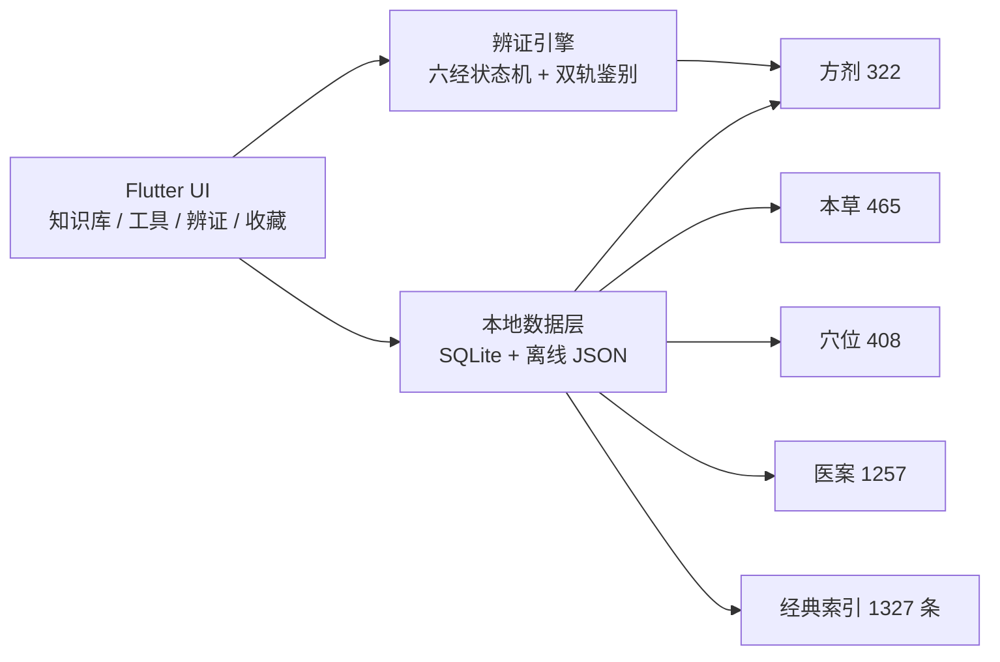

### 诊断引擎设计

**4 级方剂匹配策略：**
1. 精确匹配 `name`
2. 别名匹配 `alias`
3. 斜杠分割匹配（如"小柴胡汤/大柴胡汤"取第一个）
4. 子串匹配（如"桂枝加厚朴杏仁汤"匹配"桂枝汤"）

**口语增强匹配（V1.11.9 新增）：** 在上述基线字面匹配之上，叠加 `FormulaMatcher` 的口语语料加权命中——辨证指针 `indicators` 权重 0.4、患者口语 `oral` 权重 0.15，语料按「、」与句读切分成片段后逐片段比对，并**过滤否定词**（"无便秘"不计为"便秘"命中）。增强分上限 `enhancementCap = 0.9`，严格小于 1，从数学上保证**基线分更高者永远排前**：新语料只负责捞回原本 0 命中的方剂、或在同分层内重排，绝不打乱原有正确排序。

**合病检测：** 6 经评分 → 精确条件匹配 → 方剂覆盖
**鉴别诊断：** 经 + 证型关键词 + 问诊答案 → 26 对鉴别
**六经公式分型：** 主证经 → 分型表（太阳：中风/伤寒/温病；阳明：经热/腑热；少阴：寒化/热化；厥阴：寒热错杂/血虚寒厥…），含脉象/治法/代表方/辨证要点。

---

## 📜 六经辨证体系

<div align="center">

| 经 | 主证 | 主方 | 要点 |
|:---:|:---|:---|:---|
| **太阳** | 脉浮、头项强痛、恶寒 | 桂枝汤 / 麻黄汤 | 表证第一关 |
| **阳明** | 但热不寒、胃家实 | 白虎汤 / 承气汤 | 阳明无死证 |
| **少阳** | 口苦咽干目眩、往来寒热 | 小柴胡汤 | 半表半里，但见一证便是 |
| **太阴** | 腹满吐利、食不下 | 理中汤 / 四逆汤 | 脾虚寒湿 |
| **少阴** | 脉微细、但欲寐 | 四逆汤 / 真武汤 | 心肾阳虚，急温之 |
| **厥阴** | 消渴、气上撞心、寒热错杂 | 乌梅丸 / 当归四逆汤 | 阴之尽，寒热并结 |

</div>

---

## 🗺️ Roadmap

- [x] 六经辨证智能诊断
- [x] 完整处方生成（组成+剂量+煎服法+禁忌）
- [x] 经方加减法（23 条规则）
- [x] 合病扩展（14 种覆盖）
- [x] 鉴别诊断扩展（26 对场景）
- [x] 诊断历史趋势图（六经传变可视化）
- [x] 方剂/药物/穴位速查增强（搜索+筛选）
- [x] 子午流注取穴计算器
- [x] 经方剂量换算器
- [x] 保留 GitHub Fork 关系；上游代码按维护策略人工评估、审查和同步，版本与发行独立
- [x] 黄帝内经模块（脏象/望诊/脉诊 + 73 篇阅读库 + 全文搜索）
- [x] 附子生炮拆分（生附子/炮附子独立条目，组成引用零死链）
- [x] 倪师医案库 1257 例检索 + 闭门课重症临床模块
- [x] 七步问诊十问模块 v3.1（脉象/疼痛/呕吐类型追问）
- [x] 健康人基线判定 + 寒热真假八维法 + 六经公式分型（V1.11.8）
- [x] 患者口语语料接入：170 首方「患者会怎么说」+ 现代症状词召回（V1.11.9）
- [x] 本地原签名 Release 门禁与覆盖升级交接（正式 APK 本地构建，不启用在线发布）
- [x] Gemma 4 E4B 本地多模态输入接入（文字 / 音频 / 图像；Find N2 实机验收仍待完成）
- [ ] 舌象清晰度、曝光与色温质量检查（需在 Find N2 真机校准后实施）
- [ ] 脉诊辅助（脉象分类）
- [ ] 方剂对比功能
- [ ] 导出 PDF 诊断报告

---

## ❓ 常见问题解答（FAQ）

**Q1：App 需要联网吗？**
核心知识库（方剂、本草、穴位、医案、经典著作）均打包在本地，可离线查阅。下载本仓库新版本或使用其他在线服务时需要联网；App 不会自动检查或安装上游版本。

**Q2：我的诊断数据安全吗？**
诊断历史、收藏等数据全部存储于本机 SQLite，不上传任何服务器，隐私不出设备。

**Q3：如何取得安装包？**
本仓库不提供 GitHub Release 下载。正式 APK 由维护者本地使用原签名密钥构建并验收后交付；OPPO Find N2 使用 `arm64-v8a` 包。

**Q4：安装时提示「应用未安装」/「安装失败」怎么办？**
如果提示签名不一致，**立即停止安装，不要卸载旧版、不要清除数据，也不要换一把新密钥重新签名**。先读取设备当前 APK 的证书 SHA-256，与本地 Release APK 的证书逐字比对；只有证书一致、applicationId 一致且新版 versionCode 更高时，才执行覆盖安装。原签名密钥无法确认或指纹不一致时，保留旧版和数据并停止交付。详见 [本地 Android 构建与升级检查清单](docs/local-android-release-checklist.md)。

**Q5：紫微/易经/四柱模块是医疗功能吗？**
不是。这些模块为**中国传统民俗文化参考**，与经方医疗模块在界面与文案上明确分隔，不构成任何医疗诊断或建议。

**Q6：附子为什么分"生附子"和"炮附子"？**
遵循倪海厦"生附子是生附子、炮附子是炮附子，不能取代"的严谨口径，App 将其拆分为独立条目，方剂组成 1663 处引用全部精确解析，避免误用。

**Q7：医案库"治法/疾病"筛选是怎么分类的？**
治法栏按医案内实际出现的**经方方剂名**分类（取高频前 12）；疾病栏按**西医病名**分类（经约 150 个正名词典简繁归一抽取）。筛选逻辑均经回归测试守护。

**Q8：辨证结果里的「患者会怎么说」是什么？**
它是本 App 为 170 首经方补上的"口语画像"——把《伤寒论》《金匮要略》的文言条文译回病榻边真实会说的大白话（如桂枝汤：「身上有点发烧，虽然一直微微出汗，但风一吹过来就觉得冷，特别怕风」），并一并给出辨证指针、核心治法与可回溯的原文条文。你可以逐句对照自核"这话像不像我说的"；对引擎而言，它同时充当兜底语料，让"怕冷""怕风"这类现代症状词也能召回对应的古文方剂。

**Q9：如何参与贡献？**
欢迎提交 Issue 与 Pull Request。详见[贡献指南](#️-贡献指南)。

---

## 🤝 贡献指南

感谢你关注研纪！我们欢迎所有形式的高质量贡献。

### 行为准则

请保持友善、专业、就事论事。讨论聚焦经典还原与工程质量，尊重倪海厦学术体系的准确性。

### 代码规范

- 遵循 [Dart Style Guide](https://dart.dev/effective-dart/style) 与 `flutter_lints`；
- 提交前务必运行 `flutter analyze` 与 `flutter test`，确保 **0 error**；
- 关键辨证路径、筛选逻辑、渲染布局的改动**必须**补充/更新回归测试；
- UI 功能图标统一使用 **Material Icons**（唯一例外：八卦符 ☰☱☲☳☴☵☶☷ 为《周易》语义符号，予以保留）；
- 颜色一律通过 `lib/theme/app_colors.dart` 的语义 Token（`context.colors`）引用，禁止硬编码；
- 版本号规则：遵循 [研纪独立版本管理规范](docs/versioning-policy.md)，采用 `MAJOR.MINOR.PATCH+BUILD`；构建号必须高于同 applicationId 的已知最高构建号。

### 提交流程

1. Fork 本仓库；
2. 创建特性分支：`git checkout -b feature/amazing-feature`；
3. 提交更改（遵循 Conventional Commits）：`git commit -m 'feat: add amazing feature'`；
4. 推送分支：`git push origin feature/amazing-feature`；
5. 创建 Pull Request，并在描述中说明：改动内容、测试结果、对相关辨证/数据的影响。

### 提交信息规范（Conventional Commits）

| 前缀 | 含义 |
|:---|:---|
| `feat:` | 新功能 |
| `fix:` | 缺陷修复 |
| `docs:` | 文档变更 |
| `refactor:` | 重构（无功能变化） |
| `test:` | 测试相关 |
| `chore:` | 构建/工具链 |

---

## 📄 开源许可

本仓库采用按内容来源、文件状态和权属划分的分层许可，并非整个项目统一适用 Apache 2.0：

- **上游原始代码及未修改部分**：继续遵循根目录 [LICENSE](LICENSE) 中的 Apache License 2.0。Apache 2.0 允许商业使用；本 Fork 不撤销上游作者已经授予的权利。
- **Fork 自有新增内容**：仅对 just2512 实际拥有版权或取得充分再许可权的新增实现、品牌、工程和文档内容适用 [Fork 商业授权许可](LICENSE-FORK-COMMERCIAL.md)。个人可以在个人设备或非商业研究环境中使用、修改和编译；对本 Fork 自有修改的 GitHub 服务外公开再分发，须事先取得权利人书面许可；商业或经营性用途另须书面商业授权。
- **混合文件**：上游原始部分保留 Apache 2.0；Fork 自有修改部分适用商业授权。逐文件表达式为 Apache-2.0 AND LicenseRef-Nihaixia-Fork-Commercial。
- **AI 功能**：本地模型、统一助手、上下文检索、工具适配、情境提问、结果解释、Native 生命周期、AI 数据和 TRACE 等属于 Fork 自有实现的部分，均按同一商业授权边界处理，不按 AI 功能写入时间区分；详情见 [AI 功能商业授权清单](docs/ai-commercial-license.md)。
- **知识库与资料**：经典原文、讲义、医案、本草、方剂、穴位、针灸和易学资料继续遵循各自原许可证、来源声明或授权条件，不纳入本次商业授权。
- **第三方组件和服务**：Flutter、Dart、Android、插件、SDK、依赖、模型/权重、外部 API 和第三方资源继续遵循各自许可证或服务条款。

完整逐文件映射见 [Fork 修改文件清单](docs/fork-license-file-inventory.md)、[机器可读清单](docs/fork-license-file-inventory.json) 和 [.reuse/dep5](.reuse/dep5)。根目录 LICENSE 保持上游 Apache 2.0 原文。

**GitHub 平台许可边界**：GitHub 服务条款 D.5 对公开仓库授予其他用户在 GitHub 服务内查看和 Fork 的平台权利；该权利不等同于允许在 GitHub 服务以外镜像、重托管、打包发布或向第三方再分发。D.6 规定向带有许可证声明的仓库添加内容时，贡献者按仓库适用许可证授权该贡献，并确认有权如此授权；因此贡献者必须遵循逐文件许可映射。**GitHub 服务条款 D.8** 规定公开仓库内容可被互联网访问，并对第三方合法访问/使用作出平台层面的约定。本仓库的书面许可要求不能撤销 D.5 明确授予的服务内 Fork 权利；GitHub 服务外的公开再分发仍按本 Fork 商业许可执行。详情见 [GitHub Terms of Service D.5–D.8](https://docs.github.com/en/site-policy/github-terms/github-terms-of-service#d-user-generated-content)。

本仓库是上游项目的 Public Fork，Fork 不能单独改为 Private；可见性取决于上游。离开 Fork network 是永久操作，独立仓库不会保留原仓库的 Issues、Pull Requests、Wiki、Stars、Watchers、评论、子 Fork 或其他元数据。本仓库当前有 9 个开放 PR（包括 #332）。本次不执行离网或可见性变更；既有公共副本和本地克隆也不会因本仓库离网而自动删除。

本授权说明与文件清单用于明确工程许可边界，不替代版权权属证明或法律意见。

---

## 📚 参考资料

| 来源 | 内容 |
|:---|:---|
| 倪海厦《人纪》 | 伤寒论、金匮要略、黄帝内经、针灸大成、神农本草经 |
| 张仲景《伤寒论》 | 六经辨证体系 |
| 张仲景《金匮要略》 | 杂病辨证 |
| 《神农本草经》 | 药物性味归经（448 种） |
| jangviktor-web/nihaixia-app（Apache-2.0） | 本项目的原始开源项目来源之一；感谢原作者提供早期代码基础。本仓库保留 Fork 关系，上游改动按维护策略人工评估同步 |
| Wsy-prog/tcm-diagnosis-system（MIT） | 核心中医辨证模块结构借鉴（v3.4），为六经辨证问诊增强提供对照参考 |
| ziwei_core（Dart, MIT） | 紫微斗数 / 八字 / 命卦排盘引擎（纯离线） |
| sxwnl_spa_dart（Dart） | 历法 / 真太阳时 / 节气计算（农历 · 干支 · 节气） |

> 本 App 使用或参考了上述开源项目，并按各自适用许可证保留来源与归属说明。特别感谢原始项目 [jangviktor-web/nihaixia-app](https://github.com/jangviktor-web/nihaixia-app) 的作者，以及所有开源组件作者和社区贡献者。研纪在本仓库独立维护产品定位、版本与发布；上游 Fork 关系继续保留，代码更新按维护策略人工审核同步。

---

## ⚠️ 免责声明

本 App 面向中医诊疗全过程学习，覆盖问诊、辨病辨证、病机、治法、方剂配伍、针灸思路、经典依据与医案复盘。辨病辨证结果由 App 既有确定性规则执行，并关联可追溯的本地知识依据；AI 负责理解、追问和解释已校验结果，不凭自身推断生成诊断或覆盖规则结论。命理相关模块为传统民俗文化参考，与医疗无关。

---

## 🌟 Star History

[](https://repostars.dev/?repos=just2512%2Fnihaixia-app&theme=grape)

---

<div align="center">

**⭐ 如果这个项目对你有帮助，请给个 Star！**

</div>
